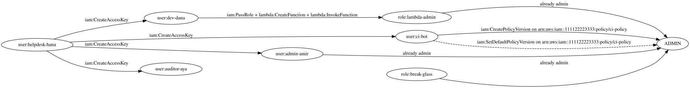

# IAM Pathfinder
Find shortest candidate IAM privilege-escalation paths from JSON snapshots of users, groups, roles and policies in a simplified offline model.

## Why this exists
Built to understand IAM privilege escalation from the inside.
Policy decisions become graph edges and candidate paths to admin.
An educational prototype, not production-ready.

## Quick start
Python 3.9+, standard library only. No AWS access is needed; the tool never calls AWS.
```sh
git clone https://github.com/aldhaib-osama/iam-pathfinder.git
cd iam-pathfinder
export PYTHONPATH=src
python3 -m iampathfinder.cli examples/snapshot.json
python3 -m iampathfinder.cli examples/snapshot.json --dot | dot -Tpng -o graph.png
```
Graph output needs Graphviz. DOT returns finding status too: 3 when candidates exist. With shell pipefail enabled, handle that expected status even when Graphviz renders successfully.

<details>
<summary>Optional installation</summary>

Setuptools is installation-only; no third-party runtime dependencies.
```sh
python3 -m venv .venv
# Linux/macOS; Windows: .venv\Scripts\activate
. .venv/bin/activate
python -m pip install --upgrade pip setuptools wheel
python -m pip install .
iampathfinder examples/auth_details.json --aws-export --report report.md
```

</details>

Examples: hand-written `examples/snapshot.json`; fictional AWS export `examples/auth_details.json`.

### Example output
Assistant-generated output from the fictional snapshot (not a maintainer-run claim):
```text
user:auditor-aya: no escalation path found (within modelled techniques)
user:ci-bot: CANDIDATE PATH in 1 step(s)  user:ci-bot -> ADMIN
    user:ci-bot -> ADMIN: iam:CreatePolicyVersion on arn:aws:iam::111122223333:policy/ci-policy
user:dev-dana: CANDIDATE PATH in 1 step(s)  user:dev-dana -> role:lambda-admin -> ADMIN
    user:dev-dana -> role:lambda-admin: iam:PassRole + lambda:CreateFunction + lambda:InvokeFunction
user:helpdesk-hana: CANDIDATE PATH in 1 step(s)  user:helpdesk-hana -> user:admin-amir -> ADMIN
    user:helpdesk-hana -> user:admin-amir: iam:CreateAccessKey
```



## Techniques covered
| Technique | What it needs | Status/notes |
| --- | --- | --- |
| Attach/Put policy on self or own group | Applicable self/group policy permission | Conditional when existing Deny is present; Deny can survive the change. |
| CreatePolicyVersion / SetDefaultPolicyVersion | Permission on an attached managed policy | CreatePolicyVersion can hit quotas. SetDefaultPolicyVersion needs an exported non-default admin-level version. Missing version data is unresolved; known versions without a suitable version produce no path. |
| CreateAccessKey / CreateLoginProfile / UpdateLoginProfile | Applicable permission on another user | Candidate access only; credential and execution restrictions apply. |
| sts:AssumeRole | Matching role trust; account-wide trust also needs identity Allow | Trust-aware, within the subset below; explicit identity Deny blocks direct paths. |
| UpdateAssumeRolePolicy | Applicable role trust-policy update permission | Modelled candidate technique, not verified exploitation. |
| iam:PassRole with Lambda or EC2 | PassRole plus the relevant service permissions | Service workflows and resource-scoped creation permissions are simplified. |

## How it works
- **Policy evaluation:** Allow/Deny, explicit Deny precedence, Action/NotAction, Resource/NotResource, wildcards and case-insensitive actions. Conditional Allow, potentially applicable conditional Deny and role-trust Conditions remain unresolved.
- **Graph and BFS:** An edge P -> Q means P might act as Q. BFS finds shortest non-admin-to-admin paths.
- **Raw import:** Raw import handles URL-encoded documents, inline/managed policies, group membership and policy versions; it preserves ARNs, IAM paths and partitions.
- **Boundaries and overlays:** Identity-policy paths need identity Allow and boundary Allow when present; directly named trusted principals can have direct-trust paths without identity Allow, subject to Deny and the model's boundary checks. Boundaries/overlays also restrict self-edit and direct-trust edges; identity self-edits cannot remove either.
- **Missing managed policies:** Missing managed policies, typically AWS-managed, are NOT evaluated or guessed; stderr and the report warn about them. A missing boundary policy fails loading.
- **Output formats:** Output: text, JSON or Graphviz DOT.

## Using a real AWS export
Export all pages yourself with read-only IAM permissions, without restrictive filters. **Keep exports and generated reports private; never commit real account data.**
```sh
aws iam get-account-authorization-details --output json > auth.json
python3 -m iampathfinder.cli auth.json --aws-export --report report.md
python3 -m iampathfinder.cli auth.json --aws-export --overlay my_org_denies.json
python3 -m iampathfinder.cli auth.json --aws-export --no-conditional
```
`--overlay`: JSON list of policy documents containing only Deny statements, applied account-wide; allow-list SCPs are rejected. `--report`: remediation ideas per technique, starting points, not verified fixes. `--no-conditional`: filters unresolved findings, not proof of remaining paths. DOT still draws all edges, including unresolved ones; this flag does not filter the displayed graph.
JSON is the path map only. Retain stderr diagnostics and report warnings.

## Exit codes
| Code | Meaning | Does not mean |
| --- | --- | --- |
| 0 | No candidate found within modelled techniques | Does not certify account safety. |
| 2 | Invalid/incomplete input | No completed assessment. |
| 3 | A candidate path exists, including conditional paths; usable in CI | Not proof of exploitation. |

## Limitations
- Candidate paths are not exploitation proof. "No path found" does not mean safe.
- Not modelled: allow-list SCPs, session policies, resource policies other than role trust, most Condition operators, cross-account paths, full partition-aware trust evaluation, boundary-removal/overlay-modification techniques and many known escalation techniques. Hand-written snapshots without explicit ARNs construct commercial-partition ARNs. Wildcards use simplified fnmatch, not full IAM evaluation.
- Truncated/mixed-account exports are rejected; some missing users/groups/policies are undetectable. Unknown attachments may contain Allow or Deny, making incomplete-data results wrong in either direction.

<details>
<summary>More limitations</summary>

- Console-only credentials may not enable API calls. Login profiles, key quotas, MFA, instance profiles and execution prerequisites are not fully represented.
- Role trust covers exact AWS/service principals, account root, wildcard Principal and sts:AssumeRole actions. Matching unconditional Deny blocks; conditional Deny is unresolved. NotPrincipal and other unsupported constructs are incomplete. Service trust requires AssumeRole, but service workflows remain simplified.
- The conservative IAM-admin terminal requires unconditional blanket identity Action/Resource permission, no identity Deny, an equally broad boundary if present and no potentially IAM/STS-restricting overlay Deny, even resource-scoped or conditional. This is not unrestricted account administration; some admin-equivalent combinations are missed.
- Directly named principals need boundary Allow, conservatively missing paths where AWS resource-policy rules bypass an IAM user's boundary implicit Deny. Explicit Deny remains enforced; role sessions are not modelled.
- Overlays are manual account-wide restrictions, not full SCP evaluation: OU hierarchy, account/service exceptions and organisation applicability are not evaluated.
- Full admins have no outgoing edges; Deny removing full-admin status can expose narrower edges, a documented model artefact. Seeded tests cover finite selected inputs, not mathematical proof for all restrictions.

</details>

## Testing
Run unit and seeded property tests: `python3 -m unittest discover -s tests -v`. Property tests use 150 seeded random accounts each: overlays/boundaries must not add edges for non-admin principals, subject to the admin artefact above. The assistant ran the proposed patched source locally: 50 tests passed on Python 3.10.12. This is not a claim of Dahoba's personal testing, complete AWS correctness or a hosted result for this patch.

Hosted CI for the proposed code changes must be checked after upload; no badge/result for that unuploaded patch is asserted here.

## Changelog
### Unreleased / current
- Added AWS export ingestion (inline/managed policies, group membership, policy versions).
- Added permissions-boundary evaluation and Deny overlays.
- Added version-aware SetDefaultPolicyVersion handling and Markdown remediation reports.
- Added seeded property tests; expanded trust, boundary, import and validation checks.
- Preserved imported ARNs; rejected truncated/mixed-account exports; applied restrictions to self-edit and direct-trust edges.

## Related tools
[Arabic guide](GUIDE_AR.md). Historical assistant review/test records are retained in `docs/`; they describe earlier snapshots, not personal maintainer testing or a current release guarantee.

Prefer PMapper, Cloudsplaining and AWS IAM Access Analyzer for real audits. AWS policy-evaluation reference: https://docs.aws.amazon.com/IAM/latest/UserGuide/reference_policies_evaluation-logic_policy-eval-denyallow.html

Initial code was AI-assisted.
